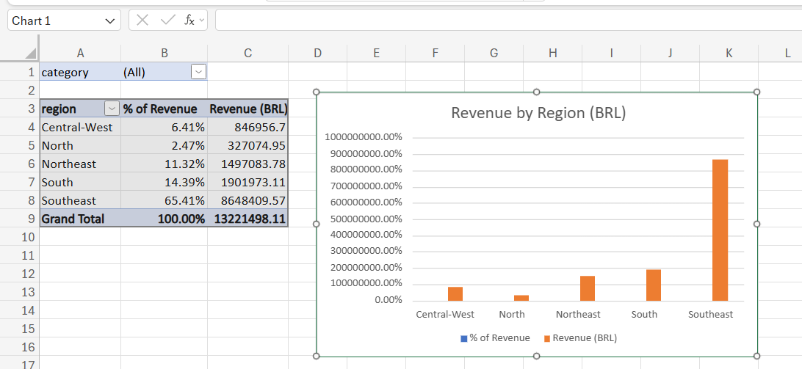
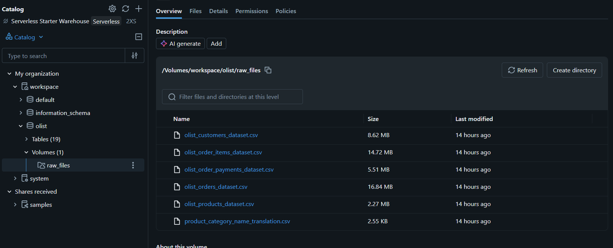
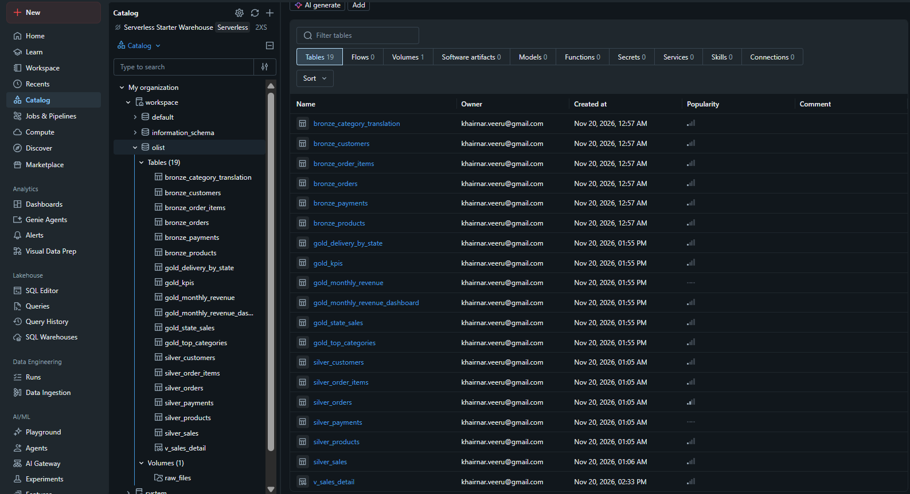
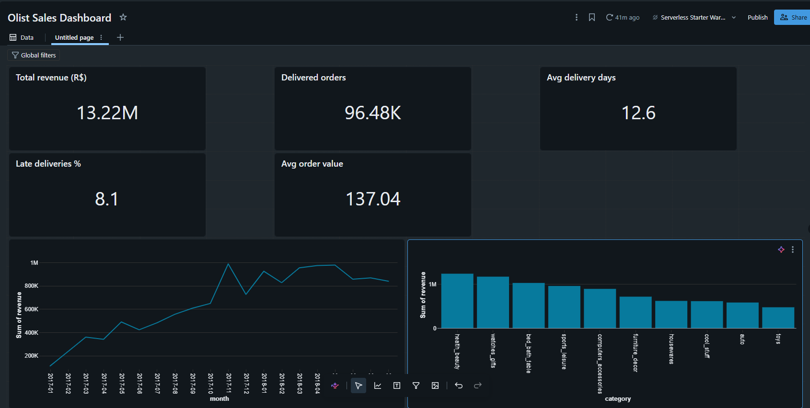
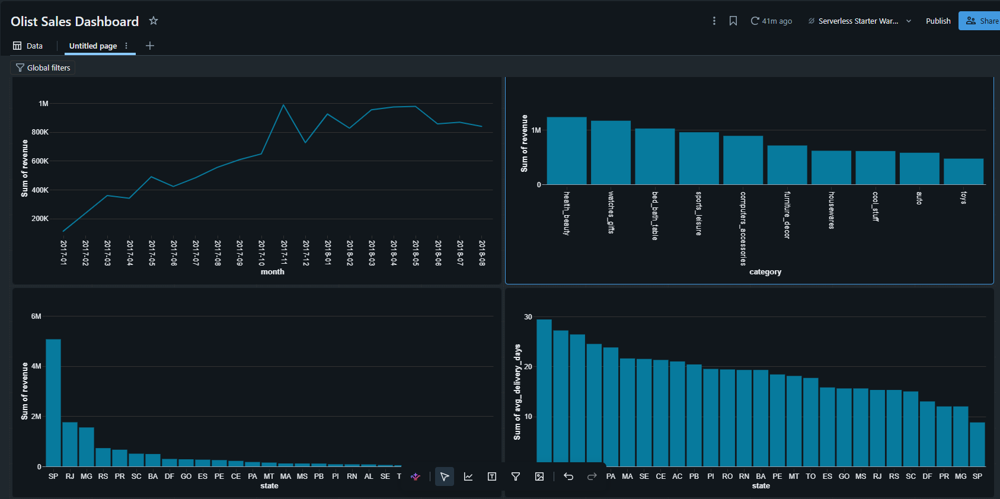

# E-Commerce Sales Performance Dashboard (Olist)

An end-to-end sales analysis of the Brazilian Olist e-commerce dataset. The same analysis is built three ways: **SQL on SQLite**, an **Excel pivot**, and a **Databricks bronze/silver/gold pipeline with a dashboard**. A **Power BI dashboard** with region and category filters is in progress (see Part 4).

**Tools:** SQL (SQLite), Python (pandas), Excel, Databricks (PySpark, Delta tables, Databricks SQL), Power BI (in progress)

**Dataset:** [Brazilian E-Commerce Public Dataset by Olist (Kaggle)](https://www.kaggle.com/datasets/olistbr/brazilian-ecommerce)
The raw CSVs and the SQLite database are not stored in this repo (they are in `.gitignore`). Download the data from the link above to rebuild everything.

---

## Goal

Answer the questions a sales or operations manager would ask:

- How much revenue did we make, and how is it trending month over month?
- Which product categories and which states drive revenue?
- How fast do we deliver, and how often do we miss the promised date?
- What is a typical order worth?

## Definitions (so the numbers can be reproduced)

| Term | Definition |
|---|---|
| Revenue | Sum of item `price` for orders with status `delivered`. Freight is excluded. |
| Orders | Distinct `order_id` among delivered orders. |
| AOV | Revenue per order (one value per order, then averaged), not per item. |
| Delivery time | Days from purchase to customer delivery, for delivered orders that have a delivery date. |
| Late | Delivered after the estimated delivery date. |
| Currency | Brazilian reais (BRL). |
| Trend window | 2017-01 to 2018-08 (20 months). The 2016 launch months have 1 to 265 orders, so their growth percentages are misleading. 2018-09 and 2018-10 have no delivered orders. |

## Data quality notes

- 99,441 orders in total, but only **96,478 are `delivered`**. Cancelled, shipped, unavailable and other statuses are excluded from revenue.
- 96,470 of the delivered orders have a delivery date. The other 8 are excluded from delivery-time metrics.
- 610 products have no category. They are labelled `unknown` (1.29% of revenue) instead of being dropped.
- Two categories have no English translation and keep Portuguese names (`pc_gamer`, `portateis_cozinha_e_preparadores_de_alimentos`, about 0.04% of revenue combined).
- The `payments` table is not joined into revenue queries. One order can have several payment rows, and joining them would duplicate item rows and inflate revenue.
- Category order counts count an order once per category it contains, so they do not add up to the total number of orders.

## Key results

| Metric | Result |
|---|---|
| Orders in dataset | 99,441 |
| Delivered orders analysed | 96,478 |
| Items sold (delivered) | 110,197 |
| Total revenue | BRL 13,221,498.11 |
| Average order value | BRL 137.04 |
| Median order value | BRL 86.57 |
| Average delivery time | 12.6 days (promised: 23.7 days) |
| Orders delivered late | 8.1% |
| Peak month | 2017-11: BRL 987,765.37 from 7,289 orders |

Revenue was checked against the same total in three places: SQLite, an Excel pivot, and Databricks.

## Business insights and recommended actions

**1. Revenue is spread across many categories, but high-ticket categories earn more per order.**
The top 3 categories (health_beauty, watches_gifts, bed_bath_table) make up 25.89% of revenue, the top 5 make up 39.83% and the top 10 make up 62.43%. No single category is above 9.33%, across 74 categories in total. watches_gifts has fewer orders than bed_bath_table (5,495 vs 9,272) but earns more revenue, about BRL 212 per order against about BRL 110.
*Action:* Spread marketing across the top 10 categories rather than betting on one. Promote high-ticket categories such as watches_gifts for revenue, and bundle low-ticket categories such as bed_bath_table to raise basket size.

**2. Revenue is concentrated in the Southeast, led by São Paulo.**
SP alone has 41.98% of orders and 38.33% of revenue. SP, RJ and MG together make up 63.38% of revenue. By region, Southeast is 65.41%, South 14.39%, Northeast 11.32%, Central-West 6.41% and North 2.47%.
*Action:* Protect fulfilment capacity in the Southeast, where most revenue is. Treat the North and Northeast as growth markets, starting with the largest of their states, and test whether faster delivery lifts orders there (this is a hypothesis; the data does not prove it).

**3. Delivery promises are conservative on average, but some states miss them often.**
Orders arrive in 12.6 days on average against 23.7 days promised, and 8.1% arrive late. Delivery time varies a lot by state: SP is fastest (8.8 days) and RR is slowest (29.4 days). Alagoas (AL) has the highest late rate among the states listed (23.9% of 397 orders), even though its delivery time (24.5 days) is not the longest, so its problem is missed promises more than distance.
*Action:* Investigate carrier performance in AL and set more realistic estimates there. In fast states such as SP, shorter delivery promises could be tested.

**4. Revenue grew through 2017, peaked in November, then flattened in 2018.**
Revenue peaked in 2017-11 (+52.4% on October), then fell 26.5% in December. Through 2018 it stayed in a band of roughly BRL 826k to 978k per month. From May 2018 (BRL 977,544.69) to August 2018 (BRL 838,576.64) it fell 14.2%. The timing of the November peak fits a Black Friday effect, but the data does not prove it.
*Action:* Plan stock and delivery capacity for November, and investigate the recent decline (category mix, region, or fewer orders).

---

## Project layout

```
.
├── sql/              # SQLite queries (CTEs, joins, window functions)
├── scripts/          # Python: inspect, load to SQLite, run SQL, export CSVs
├── outputs/          # Exported CSVs + olist_pivot.xlsx
├── databricks/       # 3 notebooks (.ipynb) + databricks_queries.sql
├── dashboard/        # Power BI file (coming soon)
├── screenshots/      # Pivot and dashboard screenshots
├── data/raw/         # (not in repo) place Kaggle CSVs here
└── README.md
```

## Part 1: SQL analysis (SQLite)

| File | What it does |
|---|---|
| `00_sanity_checks.sql` | Row counts per table |
| `01_total_revenue.sql` | Delivered orders, items, revenue, freight |
| `02_monthly_revenue_mom.sql` | Monthly revenue and MoM growth (CTE + `LAG`) |
| `02b_monthly_revenue_dashboard.sql` | Same, limited to 2017-01 to 2018-08 |
| `03_top_categories.sql` | Revenue by category, share, cumulative share (`RANK`, running `SUM() OVER`) |
| `03b_category_revenue_check.sql` | Check that the product join does not change total revenue |
| `04_orders_by_state.sql` | Orders and revenue by customer state |
| `04b_state_check.sql` | Check that state totals add up to the headline numbers |
| `05_delivery_time.sql` | Overall delivery time and late rate |
| `05b_delivery_by_state.sql` | Delivery time and late rate by state |
| `06_average_order_value.sql` | AOV, via one value per order |
| `07_sales_detail.sql` | One row per item sold, with region. Feeds Excel and Power BI. |

## Part 2: Excel pivot

`outputs/olist_pivot.xlsx` is a pivot of `sales_detail.csv` with revenue by region, a category filter and a column chart. Its grand total (BRL 13,221,498.11) matches the SQL result.



## Part 3: Databricks layer

The same analysis rebuilt as a medallion pipeline in Databricks Free Edition (serverless notebooks, Unity Catalog schema `olist`, CSVs in a Volume).

| Layer | Notebook | What it does |
|---|---|---|
| Bronze | `01_olist_bronze` | Loads the 6 raw CSVs as Delta tables, all columns as text, plus an `_ingested_at` column. Raw data is kept as it arrived. |
| Silver | `02_olist_silver` | Applies explicit types and timestamps, fixes misspelled column names, adds English category names (same `COALESCE` rule as the SQL), and checks for duplicates. Builds `silver_sales`, one row per item sold (112,650 rows). |
| Gold | `03_olist_gold` | Business-ready tables: `gold_monthly_revenue`, `gold_monthly_revenue_dashboard`, `gold_top_categories`, `gold_state_sales`, `gold_delivery_by_state`, `gold_kpis`. |

In plain words: **bronze** is the raw copy, **silver** is the cleaned and joined version, and **gold** holds the final summary tables that a dashboard reads.

- **Duplicates:** row counts before and after the duplicate check were identical in every table, so the pipeline validated that there are no duplicates (nothing was removed).
- **Reconciliation:** delivered revenue in Databricks is BRL 13,221,498.11, the same as SQLite. The gold KPIs (96,478 orders, 110,197 items, AOV 137.04, 12.6 vs 23.7 delivery days, 8.1% late) match the SQLite results.
- **SQL port:** `databricks/databricks_queries.sql` holds the queries rewritten for Databricks SQL. The main syntax changes were `strftime` to `date_format`/`trunc`, `julianday` to `unix_timestamp` differences divided by 86,400, and three-part table names (`catalog.schema.table`). CTEs and window functions carry over unchanged.
- **Databricks dashboard:** "Olist Sales Dashboard" with 5 KPI counters and 4 charts (monthly revenue, top 10 categories, revenue by state, average delivery days by state), all reading from the gold tables.

**Raw CSVs uploaded to a Unity Catalog Volume**



**Bronze tables in the `olist` schema**



**Databricks dashboard**





## Part 4: Power BI dashboard (in progress)

**Status:** not built yet. This section will be updated with screenshots and the `.pbix` file.

Planned design: Power BI will read one table, `outputs/sales_detail.csv` (110,197 rows, one per item sold, already exported and verified), so that a single region or category filter changes every visual.

- **KPI cards:** Total Revenue, Orders, Average Order Value
- **Monthly revenue trend** line chart
- **Top categories** bar chart
- **Filters (slicers):** region and category

Target values with no filters applied, from the SQL results: BRL 13,221,498.11 revenue, 96,478 orders, BRL 137.04 AOV.

## How to run it yourself

**SQLite part**

```bash
pip install pandas
# 1. Download the dataset from Kaggle (link above) and unzip the CSVs into data/raw/
python3 scripts/inspect_data.py            # check sizes, columns, missing values
python3 scripts/load_to_sqlite.py          # builds data/olist.db
python3 scripts/run_sql.py sql/01_total_revenue.sql          # run any query
python3 scripts/export_outputs.py          # writes CSVs into outputs/
```

**Databricks:** upload the 6 CSVs to a Unity Catalog Volume, then import and run the notebooks in `databricks/` in order (01, 02, 03).

## Limitations

- The data covers 2016-09 to 2018-10 only. The 2016 months and the last months of 2018 have little or no delivered-order data, so the trend uses 2017-01 to 2018-08.
- Revenue is based on item price only. Freight and payment-level details are excluded.
- Revenue per order for small states rests on very few orders (for example, AC with 80 and AP with 67 orders), so those figures are not used for conclusions.
- Findings describe what happened. They do not prove why (for example, the November peak).